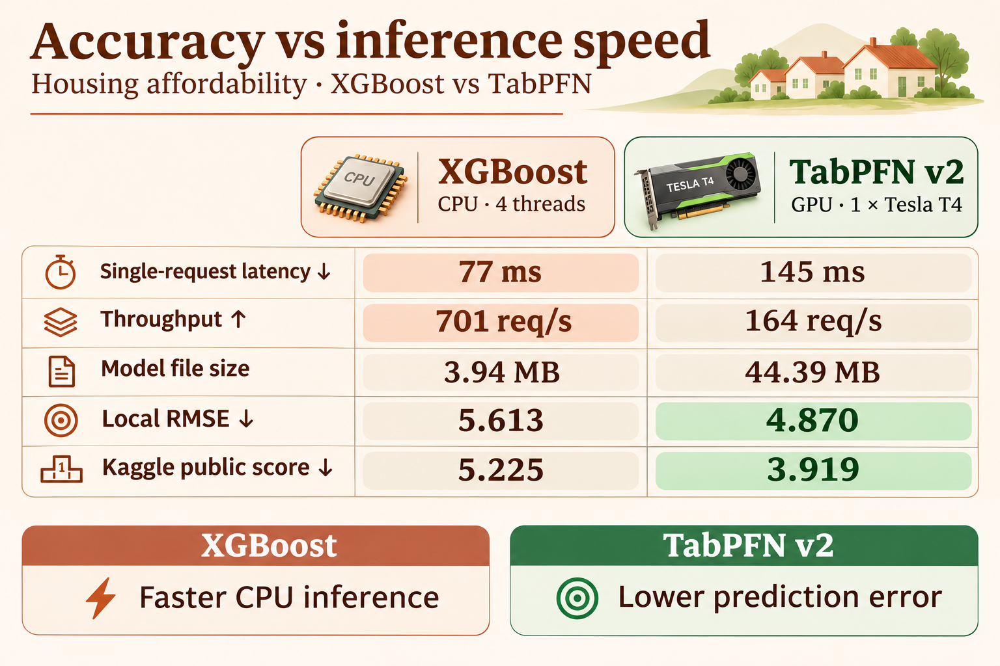

<p align="center">
  
</p>

<h1 align="center">Housing Affordability with TabPFN</h1>

<p align="center">
  Tabular foundation models for US housing affordability, with reproducible evaluation, optimized inference and model interpretation.
</p>

<p align="center">
  <a href="https://www.kaggle.com/competitions/predicting-housing-affordability-in-the-u-s">Competition</a>
  · <a href="docs/model-comparison.md">Model comparison</a>
  · <a href="experiment.md">Experiments</a>
</p>

[](https://www.python.org/)
[](https://github.com/PriorLabs/TabPFN)
[](experiment.md)

[Install](#install) · [Serve predictions](#serve-predictions) · [Interpret](#interpret-predictions) · [Benchmarks](docs/serving.md)

**Best public score: 3.859**, using TabPFN v2 with property-type features and
monthly-change forecasts for seen ZIPs. [Experiment and reproduction details](experiment.md#focused-v2-improvements-from-the-3919-submission).

The graphic and HTTP service describe the original v2 benchmark configuration,
which scored 3.919; the latest research pipeline has not been speed-benchmarked.
The graphic's local RMSE is the average across two ZIP-held-out splits.
[Measurement details](docs/model-comparison.md) explain batching settings,
model file sizes and validation. Public scores use external data and are
not competition-eligible.

## Install

Use Python 3.10 or newer with a CUDA-enabled PyTorch environment for GPU runs:

```bash
python -m venv .venv
source .venv/bin/activate
pip install -e .
```

For the optional TabICL blend, install `pip install -e '.[experiments]'`.
TabPFN downloads its public checkpoint on first use. Put the competition files
in `data/`, then download the external feature sources using the commands in
[docs/serving.md](docs/serving.md).

## Serve predictions

```bash
housing-affordability-server --cache
```

For the optimized single-T4 path, run:

```bash
housing-affordability-server --cache --optimize --batch-window-ms 5
```

In the original before/after benchmark, this reduced single-request HTTP
latency from **669 ms to 148 ms** and increased throughput at 256 clients from
**111 to 156 requests/second**. Predictions matched the cached baseline on
all 1,704 test ZIPs and two held-out splits. See
[measured settings and XGBoost comparison](docs/serving.md#final-single-t4-comparison).

The server accepts `POST /predict` requests containing ZIP-level records. It
uses the latest known target for seen ZIPs and the fitted model for unseen ZIPs.
See [docs/serving.md](docs/serving.md) for the request format, reproducibility
instructions, measured accuracy tradeoff and security limitations.

The same service can be used directly from Python:

```python
import pandas as pd
from housing_affordability.server import HousingService

history = pd.read_csv("data/train.csv", dtype={"Zip": str})
service = HousingService(history, cache=True, optimize=True)
records = pd.read_csv("data/test.csv", dtype={"Zip": str}).head(1).to_dict("records")
predictions = service.predict(records)
```

An earlier single-T4 cached run measured **0.53 seconds for one unseen ZIP**
and **7.37 seconds for 1,704 ZIPs** in process. These timings exclude HTTP and
network overhead and use three warmed measurements. The cache changes
predictions slightly; full benchmarks are in [docs/benchmarks](docs/benchmarks/).

## Interpret predictions

`housing_affordability.interpret` provides grouped permutation importance on
held-out data and local group sensitivity. In one held-out sample, the model
relied most on Zillow home values and income/rent features. These diagnostics
measure model behavior and are not causal explanations. See
[docs/serving.md](docs/serving.md#interpretability) for details and limitations.

## Repository layout

- `housing_affordability/` — feature construction, model inference, HTTP service and interpretation.
- `experiments/external_acs/` — retained data downloads, local evaluation and submission workflows.
- `benchmarks/` — reproducible single-T4 and cache-quality benchmarks.
- `tests/` — service and interpretation tests.
- `docs/` — problem, data, split and serving documentation.
- `data/` — competition files and local splits.

Run tests with `python -m unittest discover -s tests`. Local evaluation splits
and their limitations are described in [docs/split.md](docs/split.md). See the
[competition rules](https://www.kaggle.com/competitions/predicting-housing-affordability-in-the-u-s/rules)
for data-sharing and external-data restrictions.
