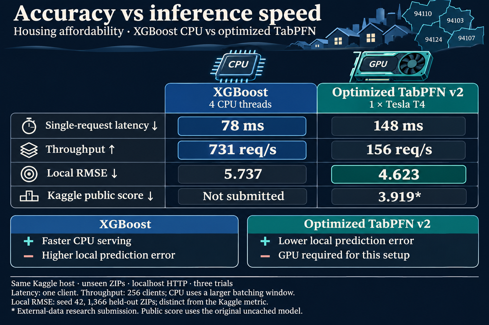

# Accuracy and inference speed

XGBoost serves requests faster on CPU. TabPFN produces lower error on both
matched local splits, at the cost of slower inference on one T4.

| Measurement | XGBoost CPU | Optimized TabPFN v2, one T4 |
| --- | ---: | ---: |
| Single-client HTTP latency | 78 ms | 148 ms |
| HTTP throughput, 256 concurrent clients | 731 requests/s | 156 requests/s |
| Local unseen-ZIP RMSE, seed 42 | 5.737 | 4.623 |
| Local unseen-ZIP RMSE, seed 137 | 5.754 | 5.117 |
| Best recorded public Kaggle score | No submission | 3.919* |

Lower latency and error are better; higher throughput is better. The local
RMSE checks are distinct from the competition's weighted metric. Each local
split holds out entire ZIPs and evaluates 1,366 June targets. Both models use
the same raw engineered features, including external sources.

## What was measured

The [completed benchmark](https://www.kaggle.com/code/atomstack001/housing-t4-final-inference-comparison)
ran on the same Kaggle host: an Intel Xeon at 2.00 GHz with four CPU threads
and one Tesla T4. Values average three trials; latency is the mean of the
single-client trial medians. Each request predicts one unseen ZIP. Clients
run on localhost, so these numbers exclude internet round trips.

TabPFN uses four estimators, the full 6,830-row context, cached inference,
the optimized attention/input path, and persistent HTTP with a 5 ms batching
window. XGBoost uses 1,000 trees, depth 5 and four CPU threads. Its latency
number uses a 0.1 ms batching window; its throughput number uses an 80 ms
window. These are different CPU serving configurations, not simultaneous
latency and throughput guarantees. XGBoost was not exhaustively tuned.

The tests use finite request waves and do not establish maximum capacity,
sustained production performance or dollar cost. See the
[full measurements](serving.md#final-single-t4-comparison) and
[raw trial data](benchmarks/final_inference_comparison.json).

## Accuracy and tradeoffs

XGBoost offers lower latency, higher throughput and CPU deployment. TabPFN
offers lower local prediction error on both tested splits, while requiring
GPU resources for this measured setup. Serving optimizations preserved the
cached TabPFN predictions exactly across both splits and all 1,704 test ZIPs.

*The public Kaggle score of **3.919** is submission **57933746**, produced by
the original uncached TabPFN model. Cached inference introduces small numerical
differences, so that leaderboard score is not a separate validation of the
optimized server. It uses external Census, Zillow and Realtor.com features
and is not eligible under the competition's external-data rules. The verified
submission history contains no XGBoost submission; no public score is inferred
from its local RMSE. The earlier **9.711** submission used LightGBM and TabICL,
and is not an XGBoost baseline.

The PNG was created using the built-in image generation tool. Its exact
[generation prompt](assets/model-tradeoff.prompt.md) is saved alongside it.
